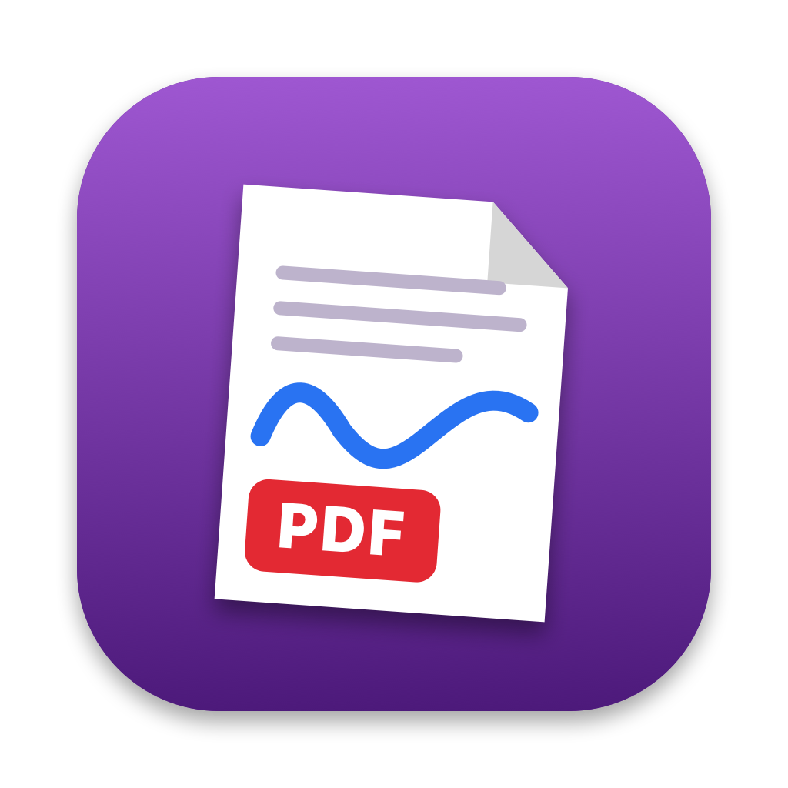

<p align="center"></p>

# OneNote → PDF

Native macOS-App, die ein komplettes **OneNote-Notizbuch inklusive Handschrift** (Tafelbilder, Tinte) als **eine einzige PDF-Datei** mit verschachtelten Lesezeichen exportiert.

OneNote für Mac bietet nur „Datei → Als PDF speichern“ für eine einzelne Seite. Diese App automatisiert genau diesen Weg für alle ausgewählten Abschnitte und Seiten und fügt die Ergebnisse zusammen.

## Funktionen

- Liest die Abschnitte (inkl. verschachtelter Abschnittsgruppen) des in OneNote geöffneten Notizbuchs aus
- Abschnitte und Gruppen einzeln an- und abwählbar
- Exportiert jede Seite über OneNotes eigene PDF-Funktion – Handschrift, Bilder und Formatierung bleiben erhalten
- Eine gemeinsame PDF mit Lesezeichen: Abschnittsgruppe → Abschnitt → Seite → Unterseite
- **Paket für Claude-Projekte** (siehe unten): pro Abschnitt eine PDF und eine Textdatei, dazu ein Inhaltsverzeichnis
- Probelauf mit 3 Seiten, Fortschrittsanzeige, Abbrechen jederzeit; bei Abbruch oder Fehler bleibt das bisher Fertige als „… (unvollständig)“ erhalten
- Zwischendateien werden nach dem Export (auch nach Fehler oder Abbruch) automatisch gelöscht
- Keine Anmeldung, kein Cloud-Zugriff, keine Azure-Registrierung – alles läuft lokal

## Wie es funktioniert

1. Die App steuert die OneNote-Desktop-App über die **Bedienungshilfen-API** (Accessibility): Seiten auswählen, Menü „Datei → Als PDF speichern“ auslösen, Speichern-Dialog ausfüllen und bestätigen.
2. Jede Seite wird kurz in den Home-Ordner gespeichert (dort fragt macOS keine Ordnerrechte ab) und sofort in einen Cache-Ordner verschoben.
3. Mit PDFKit werden alle Einzel-PDFs zu einer Datei zusammengefügt und Lesezeichen angelegt.

Warum nicht die Microsoft-Graph-API? Sie liefert **keine Handschrift/Tinte**.

## Installation

Voraussetzungen: macOS 13 oder neuer, Xcode bzw. Command Line Tools (Swift 5.9+), Microsoft OneNote für Mac.

```sh
git clone https://github.com/makro5652/OneNoteToPDF.git
cd OneNoteToPDF
./build.sh
open OneNoteToPDF.app
```

Die App wird ad-hoc signiert. Beim ersten Start ggf. Rechtsklick → „Öffnen“.

**Berechtigung:** Systemeinstellungen → Datenschutz & Sicherheit → **Bedienungshilfen** → `OneNoteToPDF` aktivieren. Nach einem Neubau muss die Freigabe unter Umständen erneut erteilt werden (alten Eintrag vorher mit „−“ entfernen).

## Benutzung

1. In OneNote das gewünschte Notizbuch öffnen; die Seitenleiste mit Abschnitts- und Seitenliste muss sichtbar sein.
2. In der App **„Abschnitte aus OneNote lesen“** klicken (Abschnittsgruppen werden dabei in OneNote aufgeklappt) und die gewünschten Abschnitte anhaken.
3. Zuerst den **Probelauf (3 Seiten)** starten, dann **„Alles exportieren“**.
4. Speicherort der PDF wählen. Während des Exports Maus und Tastatur nicht benutzen und OneNote nicht bedienen.

Dauer: je nach Seite wenige Sekunden. Ein Notizbuch mit mehreren hundert Seiten dauert entsprechend lange; die Wartezeit nach dem Seitenwechsel lässt sich im Fenster anpassen (bei viel Tinte nicht zu kurz wählen).

## Export für Claude-Projekte

Unter „3 · Export“ lässt sich statt „Eine gemeinsame PDF“ das **Paket für Claude-Projekt** wählen. Die App legt einen Ordner an:

| Datei | Inhalt |
|---|---|
| `00 INDEX.md` | Anleitung, Vorschlag für die Projektanweisung, Inhaltsverzeichnis (Seitentitel → PDF-Datei und Seite) |
| `01 <Abschnitt>.pdf` | Alle Seiten des Abschnitts mit Handschrift/Bildern (höchstens 80 Seiten und ca. 20 MB; größere Abschnitte werden zu `… (Teil 1).pdf`, `… (Teil 2).pdf`) |
| `01 <Abschnitt>.md` | Text der Seiten (aus der PDF-Textebene), je Seite mit Verweis auf PDF und Seitenzahl |

- **Texterkennung (OCR, optional):** Seiten ohne Textebene (z. B. nur Handschrift oder Bilder) werden mit Apple Vision lokal erkannt und in der `.md` als „per Texterkennung“ gekennzeichnet. Bei Handschrift ist die Erkennung unzuverlässig; maßgeblich ist immer die PDF. Seiten mit Text *und* Handschrift werden nicht per OCR gelesen, die Handschrift steht dann nur in der PDF.
- **Hochladen:** Es gibt keine öffentliche Schnittstelle, um Projektwissen automatisch zu befüllen. Den Ordner auf claude.ai unter *Projekte → Projektwissen* hineinziehen (die App öffnet auf Wunsch die Projekte-Seite).
- Das Projektwissen ist größenbegrenzt; bei großen Notizbüchern nur die benötigten Abschnitte exportieren.
- Test ohne OneNote: `OneNoteToPDF.app/Contents/MacOS/OneNoteToPDF --selftest-package /Ausgabeordner`

## Grenzen und Hinweise

- **Getestet nur mit deutscher OneNote-Oberfläche.** Die App sucht Menüpunkte und Listen anhand ihrer Namen („Datei“, „Als PDF speichern“, „Liste der Abschnitte“, „Liste der Seiten“, Dialog „Sichern“/„Ort:“). Englische Menünamen sind teilweise berücksichtigt, die Listennamen aber nicht.
- Die App hängt an der inneren Struktur von OneNote für Mac. Ein OneNote-Update kann sie brechen.
- Während des Exports wird OneNote bedient; Hintergrundbetrieb ohne Störung ist nicht garantiert.
- Die App hält Bildschirm und Mac während des Exports wach. Manuelles Sperren, Zuklappen des Laptops oder Abmelden unterbricht den Export trotzdem.
- Inoffizielles Projekt, nicht mit Microsoft verbunden. OneNote ist eine Marke der Microsoft Corporation.

## Fehlersuche

Jeder Export schreibt ein Protokoll nach `~/OneNoteToPDF/lauf.log` (Schritte, Dialogaufbau bei Fehlern). Achtung: Es kann Notizbuch- und Abschnittsnamen enthalten – vor dem Weitergeben prüfen.

Nur-Lese-Diagnose ohne Änderungen an OneNote:

```sh
OneNoteToPDF.app/Contents/MacOS/OneNoteToPDF --probe
```

## Projektaufbau

| Datei | Zweck |
|---|---|
| `Sources/OneNoteToPDF/Driver.swift` | Steuerung von OneNote über die Bedienungshilfen |
| `Sources/OneNoteToPDF/Exporter.swift` | Ablauf, Fortschritt, Aufräumen |
| `Sources/OneNoteToPDF/Assembler.swift` | Zusammenfügen der PDFs, Lesezeichen |
| `Sources/OneNoteToPDF/ContentView.swift` | SwiftUI-Oberfläche |
| `tools/make_icon.swift` | Generator für das App-Icon |
| `build.sh` | Baut und signiert `OneNoteToPDF.app` |

## Lizenz

Apache License 2.0 – siehe [LICENSE](LICENSE) und [NOTICE](NOTICE).

Du darfst das Projekt frei nutzen, verändern und weitergeben, auch kommerziell. Bei Weitergabe müssen der Lizenztext und der Hinweis aus der `NOTICE`-Datei erhalten bleiben, und Änderungen sind kenntlich zu machen.

Copyright 2026 Marvin Kronsbein
